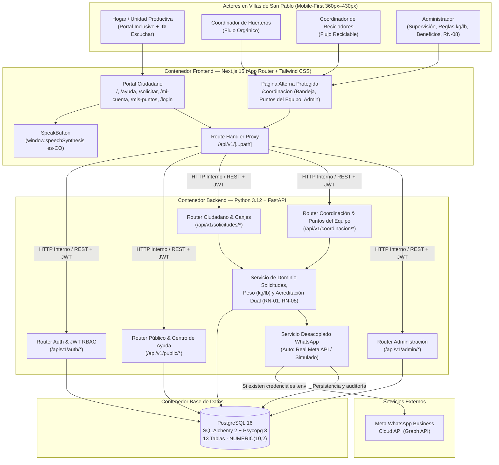
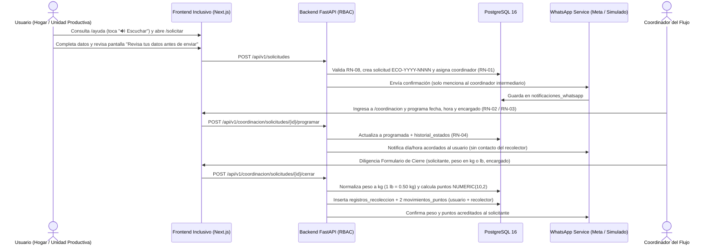
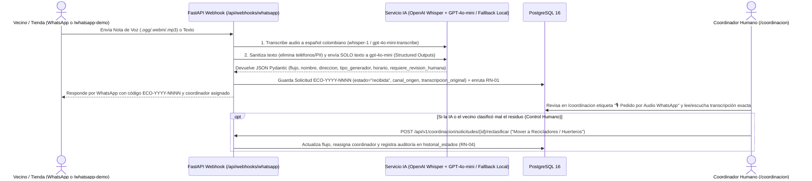

# Arquitectura del Sistema — EcoConecta · Villas de San Pablo

Alianza **Fundación Santo Domingo** y **Universidad Libre**.

## 1. Diagrama de Componentes y Servicios

---

## 2. Flujo de Intermediación, Peso (`kg` / `lb`) y Acreditación Dual

---

## 3. Flujo de Ingesta por WhatsApp (Notas de Voz / Audio y Texto) + OpenAI + Control Humano

### Decisiones de Diseño de IA, Privacidad y Control Humano

1. **Privacidad por diseño (Solo Texto Transcrito y Sanitizado):**
   - El módulo `backend/app/services/ai_extractor.py` ejecuta `sanitize_transcript_for_llm(transcripcion)` antes de llamar a `gpt-4o-mini`.
   - El número telefónico del remitente (`from` del webhook de Meta) y cualquier teléfono dictado dentro del audio se reemplazan por `[TELEFONO_RESERVADO]`, garantizando que **jamás se envíen teléfonos ni metadatos personales innecesarios** a la API externa de OpenAI (cumpliendo **RN-07**).
2. **Extracción Estructurada con Pydantic + Fallback Determinístico Local:**
   - Cuando `OPENAI_API_KEY` está configurada, utiliza `client.beta.chat.completions.parse(..., response_format=ExtraccionSolicitudWA)` con `gpt-4o-mini` para obtener una estructura tipada y validada.
   - Si `OPENAI_API_KEY` no está configurada en `.env` (o si la red falla), activa automáticamente `deterministic_keyword_parser()`, que clasifica residuos orgánicos (`cáscaras, comida, restos, abono, plátano, yuca, verdura`) frente a reciclables (`cartón, plástico, botellas, latas, vidrio, papel`) y detecta mezclas ambiguas (`requiere_revision_humana = true`).
3. **Control Humano Final en `/coordinacion` (Human-in-the-Loop):**
   - La IA nunca reemplaza la decisión operativa del líder comunitario: solo pre-clasifica la solicitud en estado `recibida` y guarda `transcripcion_original`, `confianza_ia` y `requiere_revision_humana`.
   - En `/coordinacion`, el coordinador lee o escucha (`🔊 Escuchar transcripción`) lo que dijo exactamente el vecino y puede pulsar **"Mover a Recicladores"** o **"Mover a Huerteros"** (`POST /api/v1/coordinacion/solicitudes/{id}/reclasificar`), dejando trazabilidad completa en `historial_estados`.

