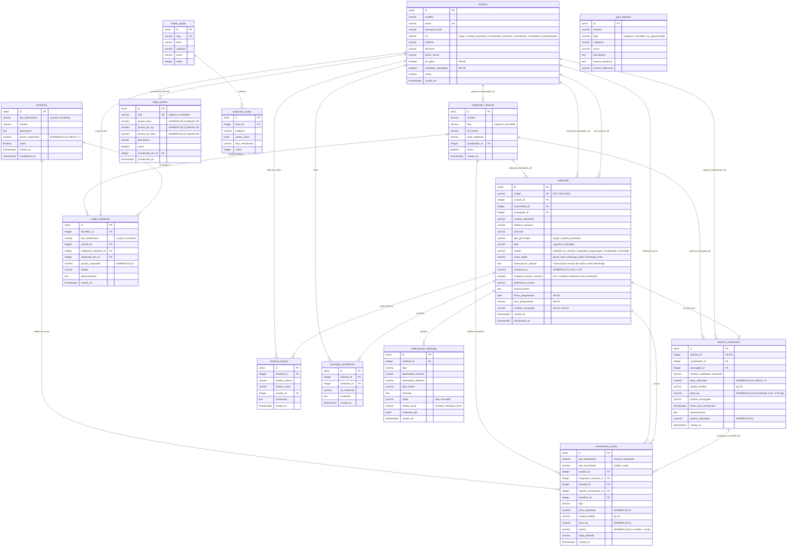

# Modelo de Datos Relacional (PostgreSQL) — EcoConecta

La base de datos está implementada en **PostgreSQL 16** mediante **SQLAlchemy 2.0** y **Psycopg 3**, con tipo `NUMERIC(10,2)` para pesos y puntajes decimales (`0.5`, `1.5`, etc.).

## Diagrama Entidad-Relación (Mermaid)

